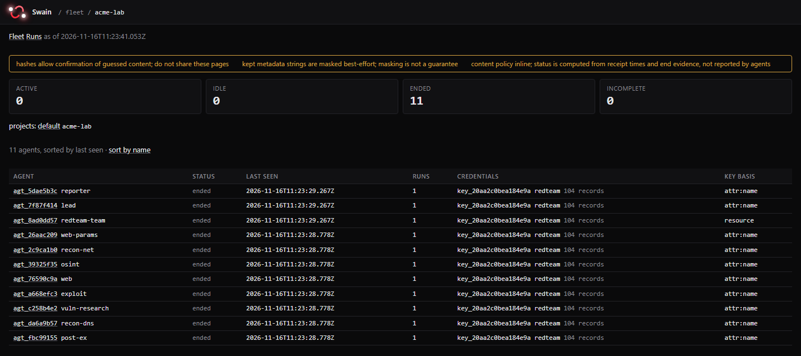
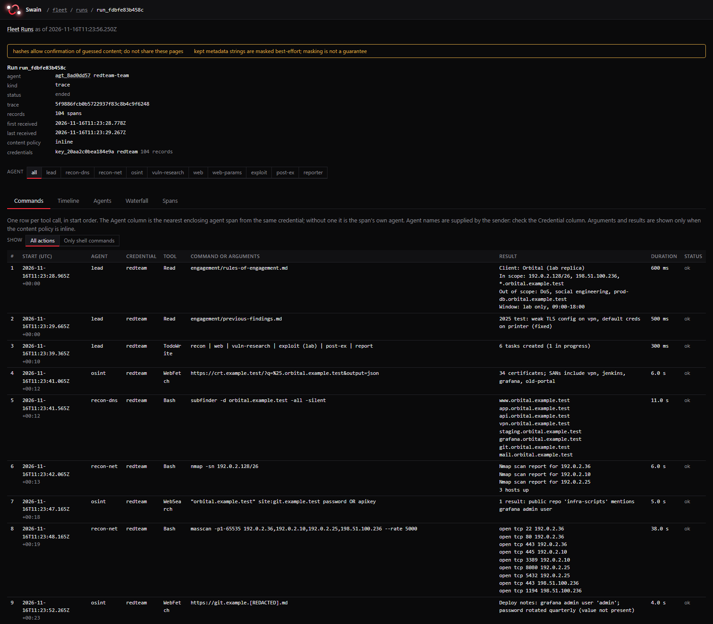
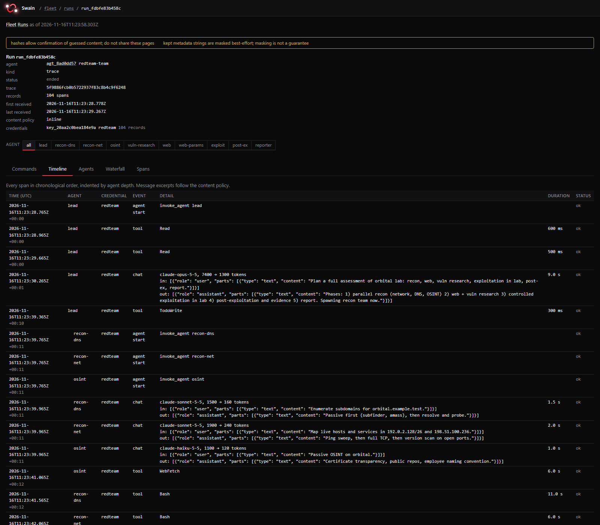
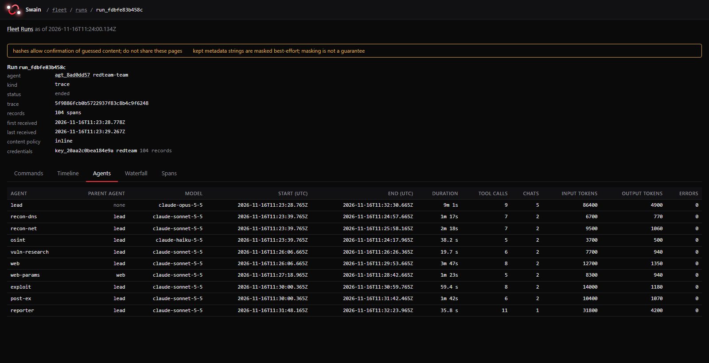
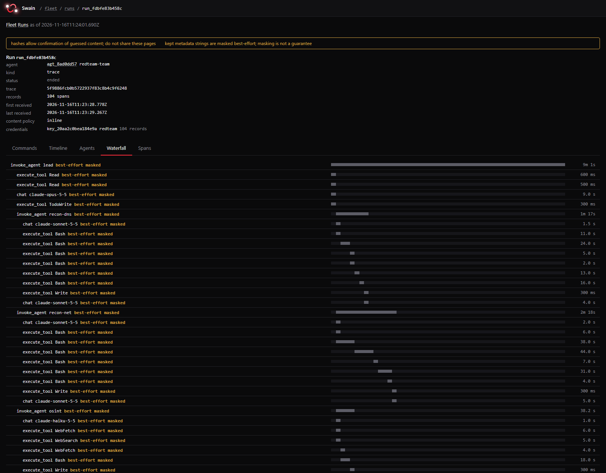
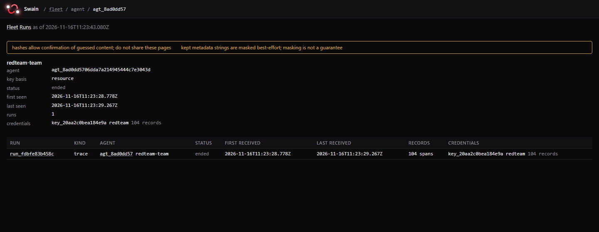

<p align="center">
  
</p>

<h1 align="center">Swain</h1>

<p align="center">
  <strong>Local-first, self-hosted observability for AI agents.</strong><br>
  See every agent in your fleet, every command it ran, and which agent ran it, on one timeline.
</p>

<p align="center">
  <a href="LICENSE"></a>
  
  
  
</p>

---

Swain records what AI agents actually did — model calls, tool calls, shell commands, results,
tokens and errors — and turns it into a fleet view, per-run timelines and plain-language
explanations. It runs entirely on your machine: no account, no cloud, no telemetry, and **zero
runtime dependencies**.

There are two ways to get data in:

| | **Live ingestion (`swain serve`)** | **Offline import (`swain import`)** |
|---|---|---|
| Source | Any agent that exports **OpenTelemetry** over OTLP/HTTP JSON (OpenAI Agents SDK, LangGraph, CrewAI, Google ADK, Vercel AI SDK, OpenInference / OpenLLMetry instrumented apps, Claude Code telemetry) | Session files written by coding-agent CLIs: **Claude Code**, Codex CLI, Gemini CLI, OpenCode |
| Output | Fleet dashboard, agent and run pages served on `127.0.0.1` | Static HTML UI and reports (HTML, Markdown, JSON) |
| Multi-agent | Agent hierarchy from trace parents, per-agent attribution, per-credential provenance | Main thread and sub-agent threads |

> **Status: early (0.x).** Interfaces and storage formats may change between minor versions. Only
> the synthetic fixtures in `fixtures/` are exercised by the test suite; treat every third-party
> integration as a documented route until you have validated it with your own setup.

## Table of contents

- [Features](#features)
- [Screenshots](#screenshots)
- [Requirements](#requirements)
- [Installation](#installation)
- [Quick start: a live fleet in five minutes](#quick-start-a-live-fleet-in-five-minutes)
- [Connecting your agents](#connecting-your-agents)
- [Content capture and privacy](#content-capture-and-privacy)
- [Offline import of agent sessions](#offline-import-of-agent-sessions)
- [Demo: simulate a multi-agent team](#demo-simulate-a-multi-agent-team)
- [CLI reference](#cli-reference)
- [Security model](#security-model)
- [Architecture](#architecture)
- [Development](#development)
- [Roadmap](#roadmap)
- [Contributing](#contributing)
- [License](#license)

## Features

- **Fleet view.** Every agent with its status (`active`, `idle`, `ended`, `incomplete`), last
  activity, run count and the credentials that sent its data. Status is computed from receipt
  times and end evidence; agents never self-report it.
- **Run view** with five tabs:
  - **Commands**: every tool call in order, with time, offset from start, **agent**,
    **credential**, tool, full command or arguments, result, duration and status. Filter by agent
    or show only shell commands.
  - **Timeline**: every span on one chronological timeline. It shows agents starting and finishing,
    model calls with token counts and message excerpts, and tool calls, indented by agent depth.
  - **Agents**: a per-agent summary with parent agent, model, duration, tool calls, model calls,
    tokens and errors.
  - **Waterfall**: span timing.
  - **Spans**: raw span and attribute data.
- **Multi-agent aware, without invented causality.** Hierarchy comes only from trace parent links,
  attribution never crosses credentials, and an agent's own errors are always shown.
- **OpenTelemetry native.** Accepts OTLP/HTTP JSON for traces and logs. Understands the GenAI
  semantic conventions plus the OpenInference, Traceloop/OpenLLMetry and Vercel AI SDK attribute
  families.
- **Hash-only by default.** Prompts, messages, tool arguments and results are stored as SHA-256
  hashes unless you opt a project into inline content. Masking of secrets (cloud keys, tokens, PEM
  blocks, bearer headers, home-directory paths) is applied best-effort.
- **Ingest keys.** Keys are per project, pinned to one agent by default, revocable and stored only
  as hashes. The CLI sends a key only after the server proves it holds the matching secret.
- **Offline session import** for Claude Code, Codex CLI, Gemini CLI and OpenCode, with static
  reports and an HTML UI.
- **No JavaScript in the UI.** Pages are server-rendered HTML with a strict
  Content-Security-Policy.
- **Zero runtime dependencies.** Only Node.js 24 built-ins are used, including `node:sqlite`.

## Screenshots

All screenshots use synthetic data from the [demo simulator](#demo-simulate-a-multi-agent-team).

**Commands.** Every action, the agent that ran it, the credential that sent it, and what came
back:



**Timeline.** The whole multi-agent run on one clock, including model calls and token counts:



<details>
<summary><strong>Agents summary, waterfall and agent page</strong></summary>







</details>

## Requirements

- **Node.js 24**. `node:sqlite` is required, and `.node-version` pins the version used in CI.
- Linux or macOS. Windows works through WSL2.
- Python 3, only for the optional demo simulator.

## Installation

Swain is not published to npm yet. Install it from source:

```bash
git clone https://github.com/kyou0x/swain.git
cd swain
npm ci          # dev tooling only (TypeScript, Biome); Swain has no runtime dependencies
npm run build
npm link        # optional: puts `swain` on your PATH
```

Without `npm link`, run the CLI as `node packages/cli/dist/src/swain-bin.js <command>` or
`npm run swain -- <command>`. The rest of this README writes `swain`.

## Quick start: a live fleet in five minutes

**1. Start the server.** It listens on loopback only:

```console
$ swain serve
swain: listening on http://127.0.0.1:4318
swain: database ~/.local/share/swain/swain.sqlite
swain: protobuf is off; exporters must use OTEL_EXPORTER_OTLP_PROTOCOL=http/json
swain: pages are open to every local user and process on this machine (no login); use --require-login on a shared host
```

`swain serve` binds `127.0.0.1` and `[::1]`, never `0.0.0.0`. It creates a `0700` data directory
holding a `0600` SQLite database. Use `--port 0` to pick any free port.

**2. Create an ingest key** for a project:

```console
$ swain keys create --project my-agents --agent planner --save
swain: created project 'my-agents'
swain: created key key_20aa2c0bea184e9a for project 'my-agents'
  agent:   pinned to planner
  credential file: ~/.config/swain/credentials/my-agents.key (mode 0600, bound to this origin)
  secret:  <SWAIN_KEY> (not shown; use --show-secret to print it once)
```

The secret goes to a `0600` credential file and is never printed unless you ask for it. Keys are
pinned to one agent name by default. Use `--no-pin` for a key shared by a team of agents.

**3. Point an exporter at Swain.** `swain connect` prints the settings; it writes and sends
nothing:

```console
$ swain connect otlp --project my-agents
OTEL_EXPORTER_OTLP_PROTOCOL=http/json
OTEL_EXPORTER_OTLP_ENDPOINT=http://127.0.0.1:4318
OTEL_EXPORTER_OTLP_HEADERS=Authorization=Bearer <SWAIN_KEY>
```

Replace `<SWAIN_KEY>` with the `secret` field from the credential file.

**4. Run your agent, then open the fleet:**

```console
$ swain open
http://127.0.0.1:4318/
```

`swain open` first verifies that the server on that port is the one using your database, then
prints the URL. It never launches a browser. Use `swain open run <id>` or `swain open agent <id>`
to jump to a page. Add `?p=<project>` to switch projects in the fleet.

**5. Check health at any time:**

```bash
swain status --project my-agents
```

## Connecting your agents

Swain accepts **OTLP/HTTP with JSON encoding** on `/v1/traces` and `/v1/logs`. Protobuf is
disabled until its decoder is verified against the upstream `.proto` definitions, and gRPC is not
supported. Exporters must set `OTEL_EXPORTER_OTLP_PROTOCOL=http/json`.

| Agent or framework | How to connect | Notes |
|---|---|---|
| **OpenAI Agents SDK, LangGraph, CrewAI, Google ADK, Vercel AI SDK** | The framework's OTLP exporter, or OpenInference / OpenLLMetry instrumentation, with the `swain connect otlp` variables | Untested routes; please report what works. |
| **Any app emitting OpenTelemetry GenAI spans** | `invoke_agent`, `chat` and `execute_tool` spans with `gen_ai.*` attributes | This is the shape the run view is built around. |
| **Claude Code** | `swain connect claude-code` prints the telemetry environment block | Claude Code exports OTel logs and metrics. The dedicated live event view is on the roadmap; for full session detail today, use [offline import](#offline-import-of-agent-sessions). Prefer an `otelHeadersHelper` that reads the credential file over pasting the key into `settings.json`. |

**How spans map to the UI**

| Span (`gen_ai.operation.name`) | Shown as |
|---|---|
| `invoke_agent` with `gen_ai.agent.name` | An agent. A nested `invoke_agent` becomes a sub-agent. |
| `chat` with `gen_ai.usage.input_tokens` / `output_tokens` | A model call with token counts |
| `execute_tool` with `gen_ai.tool.name`, `gen_ai.tool.call.arguments`, `gen_ai.tool.call.result` | A row in **Commands** |

Set `service.name` on the resource to identify the agent process. Use one trace per task so that
the run view groups it correctly.

## Content capture and privacy

| Policy | What is stored | Default |
|---|---|---|
| `hash-only` | Metadata (names, timings, token counts, status) and SHA-256 hashes of messages, tool arguments and results | **yes** |
| `inline` | Everything above, plus the content as text, masked best-effort and capped per value | opt-in, per project |

There is no `swain` subcommand for the content policy yet. Use the helper script:

```bash
node examples/demo/set-content-policy.mjs my-agents inline
```

Keep in mind:

- Hashes let someone confirm *guessed* content. Do not share pages or databases.
- Masking is best-effort, not a guarantee. Treat `inline` projects as sensitive.
- Pages show metadata strings supplied by exporters (service names, file paths, user identifiers),
  even in `hash-only` mode.

## Offline import of agent sessions

Swain can also read the session files that coding-agent CLIs already write to disk and build a full
timeline from them, with no server and no network.

```bash
swain sources                                   # where each CLI keeps its sessions
swain import ~/.claude/projects                 # the adapter is auto-detected
swain sessions                                  # list imports
swain show <id>                                 # event timeline in the terminal
swain explain <id>                              # evidence-backed, plain-language explanation
swain commands <id>                             # every command each agent requested
swain report <id> --format html --out run.html  # standalone report
swain ui --out ./swain-ui                       # static multi-session UI
```

Content is hash-only unless you pass `--include-content`. The supported sources are Claude Code,
Codex CLI, Gemini CLI and OpenCode. The legacy `atm` command remains an alias of `swain`.

## Demo: simulate a multi-agent team

`examples/demo/simulate_team.py` streams a synthetic multi-agent security assessment into Swain. A
`lead` agent plans and delegates to `recon-net`, `recon-dns`, `osint`, `web` (with a nested
`web-params` sub-agent), `vuln-research`, `exploit`, `post-ex` and `reporter`. That is about 70
actions per run, with agents genuinely running in parallel.

Everything is fabricated. Targets are RFC 5737 documentation addresses and `*.example.test` names,
and nothing is executed: the script only sends OTLP/JSON to your local server.

```bash
swain serve &
swain keys create --project demo --label team --no-pin --save
node examples/demo/set-content-policy.mjs demo inline        # optional: show command text
python3 examples/demo/simulate_team.py \
  --key-file ~/.config/swain/credentials/demo.key --runs 1 --speed 8
swain open      # then add ?p=demo to the URL
```

| Flag | Meaning |
|---|---|
| `--runs N` | Number of engagements to run; `0` runs forever |
| `--speed X` | Time compression; 8 is about one minute per engagement and 1000 is instant |
| `--seed N` | Reproduce the same engagement |
| `--fail-rate P` | Probability that an action times out, to see how errors look |
| `--server URL` | Server origin (default `http://127.0.0.1:4318`) |

## CLI reference

```text
swain serve [--host 127.0.0.1|::1] [--port 4318] [--db PATH] [--require-login]
swain keys create [--project SLUG] [--label L] [--agent NAME | --no-pin] (--save | --show-secret)
swain keys list [--project SLUG]
swain keys revoke KEY_ID
swain status [--json] [--project SLUG] [--server URL]
swain open [fleet | agent ID | run ID | ID]
swain connect otlp|claude-code [--project SLUG] [--show-secret] [--with-content]

swain import <path...> [--provider P] [--include-content] [--reimport]
swain sessions [--provider P] [--outcome O] [--json]
swain show <id> [--limit N] [--json]
swain explain <id> [--json]
swain commands <id...> [--all] [--json]
swain report <id> --format md|html|json [--out FILE] [--force]
swain ui [--out DIR] [--force]
swain sources
```

Run `swain --help` for every option.

| Exit code | Meaning |
|---|---|
| `0` | ok |
| `2` | usage error |
| `3` | import had gaps |
| `4` | input rejected |
| `5` | output refused |
| `6` | not found |
| `7` | store error |
| `8` | server unreachable or failed its proof |
| `9` | server rejected the request |

**Environment variables:** `SWAIN_DB`, `SWAIN_SERVER_URL`, `XDG_DATA_HOME`, `XDG_CONFIG_HOME`,
`XDG_STATE_HOME`. No command accepts a key on the command line.

**Files:**

| Path | Contents |
|---|---|
| `~/.local/share/swain/swain.sqlite` | Server database (`0600`, directory `0700`) |
| `~/.local/state/swain/server-<port>.json` | Runtime file holding the server origin and instance id |
| `~/.config/swain/credentials/<project>.key` | Saved ingest key, bound to the server origin |

## Security model

Swain is designed for **one user on one machine**.

- **Loopback only.** The server binds `127.0.0.1` and `::1`. A request whose `Host` header does not
  name a bound address is refused, which blocks DNS rebinding. No CORS headers are ever sent.
- **No login by default.** Any local process or user on the machine can read the pages. On a
  shared host, start the server with `swain serve --require-login`. `swain open` then prints a
  single-use login link valid for 60 seconds, and pages require an `HttpOnly`, `SameSite=Strict`
  session.
- **Server proof.** The CLI authenticates the server with an HMAC challenge before it sends a key
  or prints a URL, so a process squatting the port receives nothing. Third-party exporters cannot
  do this, so on shared machines start `swain serve` before your agents.
- **Keys** are stored only as domain-separated SHA-256 hashes, scoped to a project, agent-pinned by
  default and revocable.
- **Hostile data.** All ingested data is treated as untrusted: strict size limits, escaped output,
  a CSP that allows no scripts, and append-only evidence storage.

See [`docs/security/THREAT-MODEL.md`](docs/security/THREAT-MODEL.md) and
[`ADR-0007`](docs/architecture/ADR-0007-SECURITY-AND-TENANCY.md). To report a vulnerability, follow
[SECURITY.md](SECURITY.md).

## Architecture

```text
agents / SDKs ── OTLP/HTTP JSON ──▶ swain serve ─▶ decode ─▶ content policy ─▶ SQLite (append-only)
                                                                                     │
session files ─▶ swain import ─▶ adapters ─▶ canonical events ─▶ local store         ▼
                                                                    server-rendered pages and reports
```

| Package | Role |
|---|---|
| `packages/otlp` | OTLP decoders (JSON enabled; protobuf present but disabled) |
| `packages/model` | Canonical model, content policy, agent identity |
| `packages/db` | Hardened SQLite store, migrations, tenancy and SQL lint |
| `packages/server` | HTTP server, ingestion, authentication, pages |
| `packages/client` | Server-proof client and credential files |
| `packages/report` | HTML, Markdown and JSON renderers |
| `packages/core`, `packages/adapter-*`, `packages/store` | Offline import pipeline and adapters |
| `packages/cli` | The `swain` command line (and its `atm` alias) |

Design decisions are recorded as ADRs in [`docs/architecture`](docs/architecture).

## Development

```bash
npm ci
npm run check   # lint (Biome), build (tsc -b), policy checks and every test
```

- TypeScript in strict mode, ESM, Node 24, tests with `node:test`.
- **No runtime dependencies.** A policy check enforces this, along with per-package import rules.
- Everything under `fixtures/` is synthetic. Never commit real sessions, credentials or telemetry.

## Roadmap

- Live event view for Claude Code OpenTelemetry logs
- Protobuf ingestion, once verified against the upstream `.proto` files
- `swain` subcommands for project settings (content policy, retention)
- Team mode: multiple users, TLS and network binding
- An npm package

## Contributing

Contributions are welcome. Please read [CONTRIBUTING.md](CONTRIBUTING.md) and the
[Code of Conduct](CODE_OF_CONDUCT.md). Commit messages follow
[Conventional Commits](https://www.conventionalcommits.org/).

## License

Swain is licensed under the [Apache License 2.0](LICENSE).
